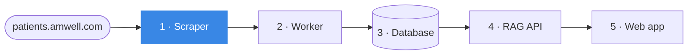

# Medical Chatbot · Scraper

**Station 1 of 5** in a data pipeline that turns public health-condition pages into the knowledge behind a chatbot.

▶ **See it explained, with a 3D walkthrough and the real data:** [medicalchatbot.demos.davieldev.com/scraper](https://medicalchatbot.demos.davieldev.com/scraper)



It reads the site's map, visits each condition page in turn, keeps what the chatbot needs (the condition's name, its symptoms, how it is diagnosed and treated) and saves every page as one JSON record in the shared database, exactly as found.

## Quick start

```bash
make install
make test                          # parser tests, offline
make run                           # every page → raw_data (start the API's Postgres first: make db-up there)
make run ARGS='--condition acne'   # one page
make run JSON=1                    # JSON files in ./scraped instead of the database
```

Without make: `uv run python main.py --help`.

| Option | What it does |
| --- | --- |
| `--all` | Every condition page (the default) |
| `--condition SLUG` | One page, for example `acne` or `acid-reflux-gerd` |
| `--list-conditions` | The pages the sitemap lists |
| `--database` | Save to the `raw_data` table (needs `DATABASE_URL`); without it, JSON files |
| `--output-dir DIR` | Folder for the JSON files (default `scraped/`) |
| `--delay SECONDS` | Pause between two pages (default `1.0`) |

## From the walkthrough to the code

Each step on the [scraper page](https://medicalchatbot.demos.davieldev.com/scraper) is one function:

| Step | Code |
| --- | --- |
| 1 · Find every page | `discover_condition_slugs()` in [`jobs/scraper.py`](jobs/scraper.py) reads `sitemap.xml`, or the `/conditions/` index if the sitemap is down |
| 2 · Visit one at a time | `scrape()` in [`jobs/scraper.py`](jobs/scraper.py): one keep-alive connection, retries, a pause between pages |
| 3 · Pick out what matters | `parse_condition_page()` in [`jobs/parser.py`](jobs/parser.py), field by field in the [HTML → JSON](https://medicalchatbot.demos.davieldev.com/scraper#mapping) table |
| 4 · Save the record | `DatabaseStore` / `JsonFileStore` in [`jobs/persistence.py`](jobs/persistence.py); see a stored [raw record](https://medicalchatbot.demos.davieldev.com/scraper#record) |

[`main.py`](main.py) is the command line. [`db/`](db/) holds the connection and the `raw_data` model, a mirror of the schema the [API](https://github.com/davidsanbric-dev/MedicalChatbotAPI) owns. [`html_structure/`](html_structure/) keeps trimmed snippets of the original page template for reference.

## Good to know

- **Raw means raw.** Text is stored exactly as on the page, non-breaking spaces included. The worker normalizes it, so `raw_data` stays a faithful copy of the source.
- **Retries, then re-runs.** Network errors and `429`/`5xx` answers are retried 3 times with exponential backoff, honoring `Retry-After`. Pages that still fail are listed at the end, and the run exits with status 1.
- **Re-runs fill gaps.** With `--database`, pages already in `raw_data` (`source = medical_conditions:<slug>`) are skipped. JSON files are always rewritten.
- **Two page templates.** The parser reads both the original layout and the site's 2026 redesign; [`tests/test_parser.py`](tests/test_parser.py) covers both.

## Docker

```bash
make docker-build
make docker-run ARGS='--condition acne'
```

The container reaches the API stack's Postgres through `host.docker.internal` (see [`.env.example`](.env.example)).

## The whole pipeline

| Station | Repository | Walkthrough |
| --- | --- | --- |
| 1 · Scraper | **MedicalChatbotScraper** (this one) | [/scraper](https://medicalchatbot.demos.davieldev.com/scraper) |
| 2 · Worker | [MedicalChatbotWorker](https://github.com/davidsanbric-dev/MedicalChatbotWorker) | [/worker](https://medicalchatbot.demos.davieldev.com/worker) |
| 3 · Database | [MedicalChatbotAPI](https://github.com/davidsanbric-dev/MedicalChatbotAPI) | [/database](https://medicalchatbot.demos.davieldev.com/database) |
| 4 · RAG API | [MedicalChatbotAPI](https://github.com/davidsanbric-dev/MedicalChatbotAPI) | [/api](https://medicalchatbot.demos.davieldev.com/api) |
| 5 · Web app | [MedicalChatbotWeb](https://github.com/davidsanbric-dev/MedicalChatbotWeb) | [/interface](https://medicalchatbot.demos.davieldev.com/interface) · [chat](https://medicalchatbot.demos.davieldev.com/chat) |

Educational demo: the content comes from a public telehealth site and is not medical advice.
